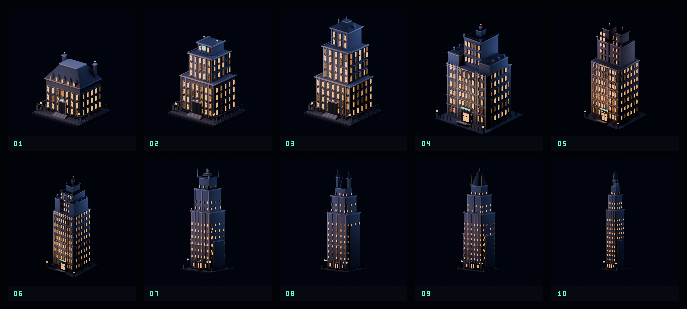

# Account buildings

Ten original Gotham-inspired, pixel-styled building assets. Their account slots are numbered so an app can assign its own account names. Heights include the display plinth and rise from 9.78 m to 45.32 m.

| Slot | Profile | Height | Render | 3D model |
| --- | --- | ---: | --- | --- |
| 01 | Mansard townhouse | 9.78 m | [PNG](account_building_01.png) | [GLB](account_building_01.glb) |
| 02 | Stepped Art Deco annex | 13.60 m | [PNG](account_building_02.png) | [GLB](account_building_02.glb) |
| 03 | Narrow setback tower | 17.68 m | [PNG](account_building_03.png) | [GLB](account_building_03.glb) |
| 04 | Broad Art Deco hall | 21.42 m | [PNG](account_building_04.png) | [GLB](account_building_04.glb) |
| 05 | Warm brick twin crown | 25.35 m | [PNG](account_building_05.png) | [GLB](account_building_05.glb) |
| 06 | Cathedral-influenced needle | 29.32 m | [PNG](account_building_06.png) | [GLB](account_building_06.glb) |
| 07 | Stepped roof crown | 33.32 m | [PNG](account_building_07.png) | [GLB](account_building_07.glb) |
| 08 | Paired Gothic spires | 37.32 m | [PNG](account_building_08.png) | [GLB](account_building_08.glb) |
| 09 | Faceted roof crown | 41.32 m | [PNG](account_building_09.png) | [GLB](account_building_09.glb) |
| 10 | Slender pinnacle | 45.32 m | [PNG](account_building_10.png) | [GLB](account_building_10.glb) |

Each slot also has an editable `.blend` file with the same basename. [manifest.json](manifest.json) contains file paths and measured heights for integration. The build scripts are `build_account_buildings_01_03.py`, `build_account_buildings_04_06.py`, and `build_account_07_10.py`.
